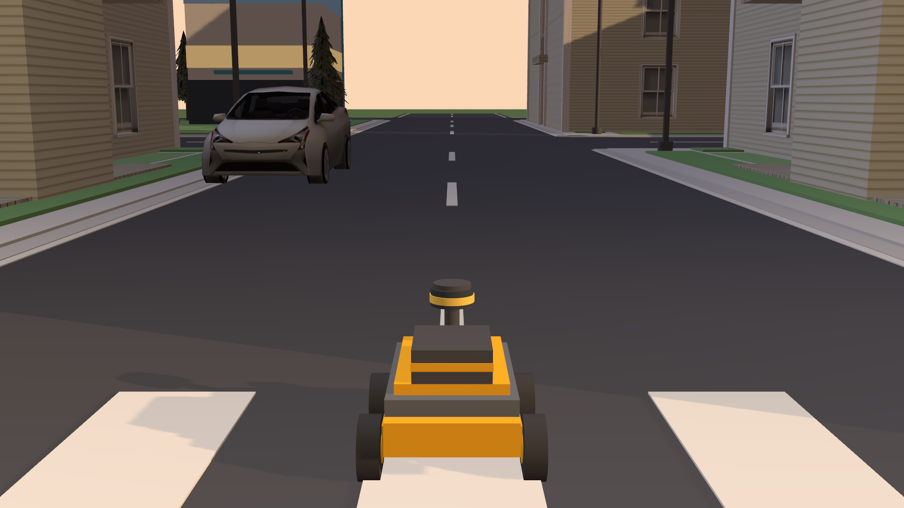
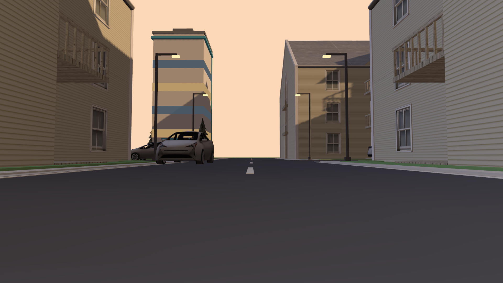
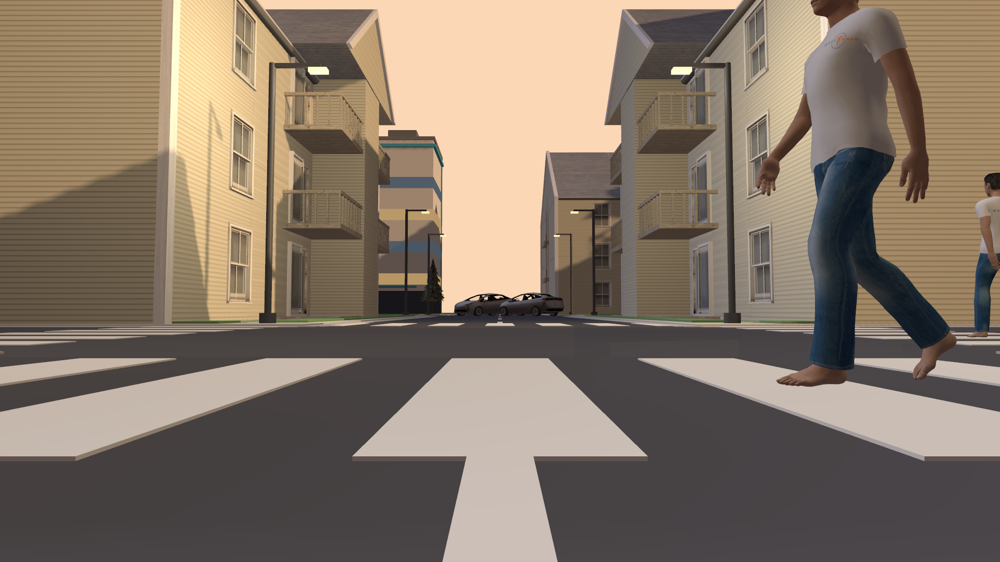
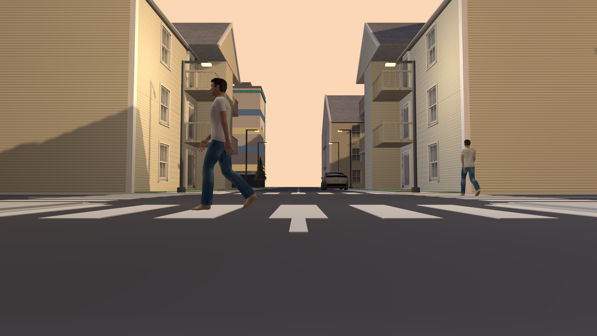

# 🌆 Dusk Runner — Autonomous Delivery Rover

[](https://docs.ros.org/en/jazzy/)
[](https://www.python.org/)
[](https://gazebosim.org/)
[](https://ubuntu.com/)
[](LICENSE)

A differential-drive delivery rover that navigates a procedurally generated
city at golden hour. It follows a five-waypoint route using IMU-augmented dead
reckoning, watches a 360° LiDAR for obstacles, yields to moving cars and
pedestrians, and can photograph its own journey at 1920 × 1080.

Built with **ROS 2 Jazzy** and **Gazebo Harmonic**. No GPU required — the whole
stack runs on CPU rendering.

---

## 📸 Screenshots

| | |
|:---:|:---:|
|  |  |
| **Third-person rig** — the rover in the apartment canyon, with an oncoming Prius. | **Golden hour** — moving traffic against the dusk skyline. |
|  |  |
| **LiDAR safety stop** — a pedestrian on the crossing holds the rover at the zebra. | **Driver's eye view** — the road and crosswalk from the front camera. |

> **Screenshots folder.** All four stills live in [`screenshots/`](screenshots/).
> If you downloaded them to your Desktop, move them into the repo before
> committing:
>
> ```bash
> cp /path/to/rover_shots/*.png screenshots/
> ```
>
> On Windows, copy `C:\Users\Lenovo\Desktop\rover_shots\*.png` into the
> repository's `screenshots\` folder. In this workspace the
> `screenshots/` folder is already populated.

---

## Overview

The rover spawns at the southern edge of a 220 m × 220 m city and starts a
clockwise loop around four blocks. Position is dead-reckoned from wheel
odometry and anchored to the spawn pose; heading comes from the IMU, which
keeps the skid-steer chassis pointed down the road without the yaw drift of
pure wheel odometry. A 20 Hz controller steers for the next waypoint, slows
into corners, turns in place when the heading error is large, and stops
outright whenever the 360° LiDAR reports something inside a 0.55 m front cone.

The streets are shared with five cars and four pedestrians. They are Fuel
models driven as *static* entities teleported along lane polylines in
simulation time, so they cost the physics engine nothing while remaining fully
visible to the rendering-based LiDAR. The rover really does wait for them —
screenshot 3 is a genuine safety stop, not a posed frame.

The city itself is generated by code: a deterministic 5 × 5 road grid, sixteen
blocks, two parks, a central zebra crossing, and a collection of Gazebo Fuel
assets lit by a warm directional sun.

## Features

- **URDF robot** — differential drive with two powered wheels and a caster,
  a 360° LiDAR mast, a forward camera, an on-demand 1080p camera and an IMU.
  Velocity and acceleration limits are enforced by the Gazebo diff-drive
  plugin.
- **IMU-augmented dead reckoning** — heading from the IMU quaternion, position
  from wheel odometry, with the spawn-relative Gazebo Harmonic convention
  detected at startup.
- **Waypoint navigator** — a five-waypoint loop with heading P-control,
  corner slowdown, in-place turns, waypoint tolerance and automatic looping.
- **LiDAR safety layer** — 720 beams at 10 Hz; the closest return inside a
  ±35° front cone below 0.55 m zeroes the velocity command until the path
  clears.
- **Dynamic traffic manager** — five cars and four pedestrians, right-hand
  lane offsets, correct mesh-heading compensation, and sim-time integration
  so traffic speed is independent of the real-time factor.
- **Procedural golden-hour city** — Fuel apartments, trees, benches and cars
  with a procedural fallback, warm sun, ambient fill and shadows.
- **Reactive driver alternative** — `mode:=auto` runs a simpler
  stop-and-turn obstacle-avoidance behaviour instead of the route follower.
- **Cinematic capture tools** — framing-aware 1080p stills from the rover and
  a temporary third-person camera rig.
- **Desktop chase camera** — the Gazebo GUI follows the rover with no mouse
  input.

## Architecture

```
                    ┌──────────────────────────────────────────────┐
                    │              Gazebo Harmonic                 │
                    │  my_city.world · traffic · diff-drive plugin │
                    └──────────────┬─────────────────┬─────────────┘
                                   │ sensors         │ /cmd_vel
                    ┌──────────────▼─────────────────▼─────────────┐
                    │                ros_gz_bridge                 │
                    └──────────────┬───────────────────────────────┘
                                   │ /lidar/scan · /imu · /odom
                    ┌──────────────▼───────────────────────────────┐
                    │             waypoint_navigator               │
                    │   dead reckoning + IMU heading               │
                    │   heading P-control · LiDAR safety stop      │
                    └──────────────────────────────────────────────┘
```

### Robot and sensors

| Sensor | Topic | Specification |
|---|---|---|
| 360° LiDAR | `/lidar/scan` | 720 samples, 0.12–30 m, 10 Hz |
| Front camera | `/camera/image` | 640 × 480, 80° HFOV, 10 Hz |
| Photo camera | `/camera/photo` | 1920 × 1080, 80° HFOV, on demand |
| IMU | `/imu` | 100 Hz |
| Wheel odometry | `/odom` | from the diff-drive plugin |

The high-resolution photo camera is declared with `always_on=false`: it only
renders while a capture tool is subscribed, so the extra pixels cost nothing
during normal driving. It is tilted up by 3° to keep the skyline in frame.

### Navigation and state estimation

- The route is a clockwise loop through
  `(0, 30) → (30, 30) → (30, −30) → (−30, −30) → (−30, 30)` and repeats.
- The rover spawns at `(0, −11)` facing north (`yaw = π/2`).
- Position comes from wheel odometry expressed in the odom frame; the
  world-frame route is transformed into that frame using the spawn pose.
- Heading comes from the IMU quaternion. At startup the navigator detects the
  IMU's heading convention and aligns it with the spawn yaw, which avoids the
  classic "rover turns the wrong way" failure after a spawn rotation.
- A 20 Hz controller applies a heading P-gain of 1.8, a maximum of 1.5 rad/s
  and a cruise speed of 1.2 m/s, dropping to 0.45 m/s within 7 m of a corner.
  Heading errors above 0.35 rad trigger an in-place turn instead of a wide arc.

### LiDAR safety layer

Every scan is reduced to the nearest return inside the ±0.61 rad front cone.
If that distance falls below 0.55 m the navigator publishes a zero twist and
holds. The check runs before the steering law, so it works for both a car
cutting across the intersection and a pedestrian on the zebra. The rover
resumes as soon as the cone is clear.

### Traffic

- `traffic_manager.py` spawns five Prius Hybrid models and four Walking Person
  models from Gazebo Fuel.
- Cars follow three counter-clockwise block loops; pedestrians cross the
  central zebra or stroll the park paths.
- Every actor is a **static** model teleported with `/set_pose_vector` at
  10 Hz of simulation time. Kinematic motion keeps the real-time factor high,
  and the rendering-based LiDAR still sees every actor.
- Lane centrelines are offset 2.9 m to the right of the road centreline, which
  keeps the rover's route clear while putting oncoming traffic close enough to
  matter.
- The Prius mesh faces −Y and the Walking Person mesh faces +Y, so their yaw
  offsets are `+π/2` and `−π/2` respectively.

### Procedural city

`scripts/generate_city.py` builds `worlds/my_city.world` deterministically:

- A 5 × 5 road grid at 30 m pitch with asphalt, edge lines, lane dashes and a
  zebra crossing at the central intersection.
- Sixteen blocks, fourteen with buildings and two parks with ponds, paths and
  benches.
- Gazebo Fuel assets — Apartment, Oak Tree, Pine Tree, FoodCourtBenchLong,
  Prius Hybrid and Walking Person — pre-warmed into the local Fuel cache with
  a procedural fallback when offline.
- A golden-hour scene: warm directional sun, warm ambient light, a cool sky
  fill and shadows. The world contains 128 entities in roughly 333 KiB.

### Capture tooling

- `highres_shot` saves frames from a Gazebo camera topic as PNGs. It can wait
  for the rover to reach a point (`--wait-near`), for a car ahead
  (`--wait-traffic`), for the safety layer to hold the robot (`--wait-stop`)
  and for an obstacle ahead (`--wait-obstacle`). It pre-warms the 1080p sensor
  before a stop shot and talks to Gazebo directly over gz-transport, so no
  image bridge is involved.
- `photo_rig` spawns a temporary static model carrying a 1920 × 1080 camera,
  locks it a configurable distance behind and above the rover with
  `/set_pose_vector`, saves a burst and removes the rig again. This is how the
  third-person close-up was taken without touching the rover's URDF.
- `chase_camera` keeps the Gazebo GUI view behind the rover using the
  `CameraTracking` plugin.

## Repository layout

```
.
├── launch/robot.launch.py         # city, robot, bridge, drivers, traffic
├── my_robot_controller/
│   ├── waypoint_navigator.py      # route following + LiDAR safety
│   ├── autonomous_driver.py       # reactive stop-and-turn driver
│   ├── traffic_manager.py         # kinematic cars and pedestrians
│   ├── chase_camera.py            # Gazebo GUI chase camera
│   ├── highres_shot.py            # timed 1080p stills
│   ├── photo_rig.py               # temporary third-person camera
│   ├── capture_frames.py          # periodic driver-view JPEGs
│   └── teleop.py                  # keyboard teleoperation
├── scripts/generate_city.py       # procedural world generator
├── urdf/my_robot.urdf             # rover description and sensors
├── worlds/my_city.world           # committed, ready-to-run city
├── screenshots/                   # the four images above
├── package.xml
├── setup.py
├── LICENSE
└── README.md
```

## Build & run

### Prerequisites

Ubuntu 24.04 with ROS 2 Jazzy, Gazebo Harmonic (installed by the ROS-Gazebo
integration), and Pillow for the screenshot tools:

```bash
sudo apt update
sudo apt install -y \
  ros-jazzy-ros-gz \
  ros-jazzy-robot-state-publisher \
  python3-pil python3-numpy
```

### Build

```bash
mkdir -p ~/ros2_ws/src
cd ~/ros2_ws/src
git clone https://github.com/<your-username>/dusk-runner.git
cd ~/ros2_ws
rosdep install --from-paths src --ignore-src -r -y
colcon build --symlink-install --packages-select my_robot_controller
source install/setup.bash
```

### Run

```bash
ros2 launch my_robot_controller robot.launch.py
```

The default launch starts Gazebo with the GUI, spawns the rover, bridges the
sensors, starts the waypoint navigator, the chase camera and the traffic
manager, and saves three driver-view JPEGs along the route.

Launch arguments:

| Argument | Default | Description |
|---|---|---|
| `mode` | `nav` | `nav`, `auto`, `teleop` or `none` |
| `traffic` | `true` | Spawn moving cars and pedestrians |
| `capture` | `true` | Save three JPEGs to `~/.ros/captures` while driving |
| `use_sim_time` | `true` | Use the Gazebo clock |
| `gz_args` | `-r <world>` | Passed to `gz sim`; use `-r -s` for headless |

Examples:

```bash
# Reactive obstacle avoidance instead of the route follower
ros2 launch my_robot_controller robot.launch.py mode:=auto

# Keyboard driving
ros2 launch my_robot_controller robot.launch.py mode:=teleop

# Quiet portfolio run
ros2 launch my_robot_controller robot.launch.py capture:=false traffic:=false

# Headless (no Gazebo GUI)
WORLD=$HOME/ros2_ws/install/my_robot_controller/share/my_robot_controller/worlds/my_city.world
ros2 launch my_robot_controller robot.launch.py gz_args:="-r -s $WORLD"
```

### Taking stills

```bash
# One frame from the 1080p photo camera
ros2 run my_robot_controller highres_shot --output ~/still.png

# Wait for the apartment canyon and a car 8–25 m ahead
ros2 run my_robot_controller highres_shot --output ~/golden_hour.png \
  --wait-near 0,10,4 --wait-traffic 8,25

# The LiDAR holding the rover for something close, as a 6-frame burst
ros2 run my_robot_controller highres_shot --output ~/stop.png \
  --wait-near 0,-4.5,4 --wait-stop --wait-obstacle 6 \
  --count 6 --interval 0.25 --warmup 0

# Third-person close-up via the temporary rig
ros2 run my_robot_controller photo_rig --output ~/closeup.png \
  --wait-near 0,8,3
```

### Regenerating the city

The committed world runs as-is. To rebuild it, or to pre-warm and texture-fix
the Fuel cache on a fresh machine (this needs internet access the first time):

```bash
python3 scripts/generate_city.py
```

## Topics

| Topic | Type | Direction | Purpose |
|---|---|---|---|
| `/cmd_vel` | `geometry_msgs/Twist` | ROS → Gazebo | Drive command |
| `/odom` | `nav_msgs/Odometry` | Gazebo → ROS | Wheel odometry |
| `/imu` | `sensor_msgs/Imu` | Gazebo → ROS | Orientation and rates |
| `/lidar/scan` | `sensor_msgs/LaserScan` | Gazebo → ROS | 720-beam scan |
| `/camera/image` | `sensor_msgs/Image` | Gazebo → ROS | 640 × 480 driver view |
| `/camera/camera_info` | `sensor_msgs/CameraInfo` | Gazebo → ROS | Camera intrinsics |
| `/tf`, `/joint_states` | tf2 / sensor_msgs | Gazebo → ROS | Robot state |
| `/clock` | `rosgraph_msgs/Clock` | Gazebo → ROS | Simulation time |
| `/camera/photo` | `gz.msgs.Image` | Gazebo (native) | On-demand 1080p |
| `/world/city/pose/info` | `gz.msgs.Pose_V` | Gazebo (native) | Ground-truth poses |

The two native topics are consumed directly over gz-transport by the capture
tools and the chase camera; they are intentionally not bridged to ROS.

## Tuning

The navigator exposes its behaviour as ROS parameters:

| Parameter | Default | Meaning |
|---|---|---|
| `cruise_speed` | 1.2 | m/s on a straight |
| `corner_speed` | 0.45 | m/s near a waypoint |
| `heading_gain` | 1.8 | rad/s per rad of heading error |
| `max_angular` | 1.5 | rad/s limit |
| `turn_in_place_angle` | 0.35 | rad error that triggers a pivot |
| `waypoint_tolerance` | 0.8 | m |
| `slow_radius` | 7.0 | m from a corner where the rover slows |
| `min_clearance` | 0.55 | m LiDAR stop distance |
| `front_cone` | 0.61 | rad half-angle of the safety cone |
| `control_rate` | 20.0 | Hz |
| `loop` | true | Repeat the route forever |
| `use_imu` | true | Use IMU heading instead of odometry yaw |

Override them at runtime, for example:

```bash
ros2 run my_robot_controller waypoint_navigator --ros-args -p cruise_speed:=1.5
```

## Performance notes

Tested on CPU-only rendering (Mesa `llvmpipe`) inside Docker on Ubuntu 24.04:

- 128 world entities, five cars, four pedestrians, a 720-beam LiDAR at 10 Hz
  and on-demand 1080p stills.
- Real-time factor measured at **0.5–0.65** with the GUI open; headless mode
  improves it.
- The 1080p camera is inactive unless a capture tool subscribes, which is why
  ordinary driving stays affordable.

Known limitations:

- Position is dead-reckoned; it drifts over long runs. There is no SLAM or
  AMCL.
- Traffic actors are kinematic and do not react to the rover. The rover yields
  to them, not the other way around.
- Intersections have no traffic lights and the route is centreline-based, not
  lane-level.
- This is a simulation project, not a road-going autonomy stack.

## Roadmap

- Nav2 integration with AMCL/SLAM for map-based localisation.
- Traffic-light state machines and explicit crosswalk yielding rules.
- Depth camera and 3D obstacle avoidance.
- Multi-robot fleet coordination.

## License

The source code is released under the [Apache License 2.0](LICENSE).

The Gazebo Fuel assets referenced by the world — Apartment, Oak Tree, Pine
Tree, FoodCourtBenchLong, Prius Hybrid and Walking Person — remain under the
licenses published with those models on
[Gazebo Fuel](https://fuel.gazebosim.org/) and are downloaded at runtime.

## Acknowledgements

Built on [ROS 2 Jazzy](https://docs.ros.org/en/jazzy/) and
[Gazebo Harmonic](https://gazebosim.org/), with model assets from
[Gazebo Fuel](https://fuel.gazebosim.org/) and the OpenRobotics collection.
